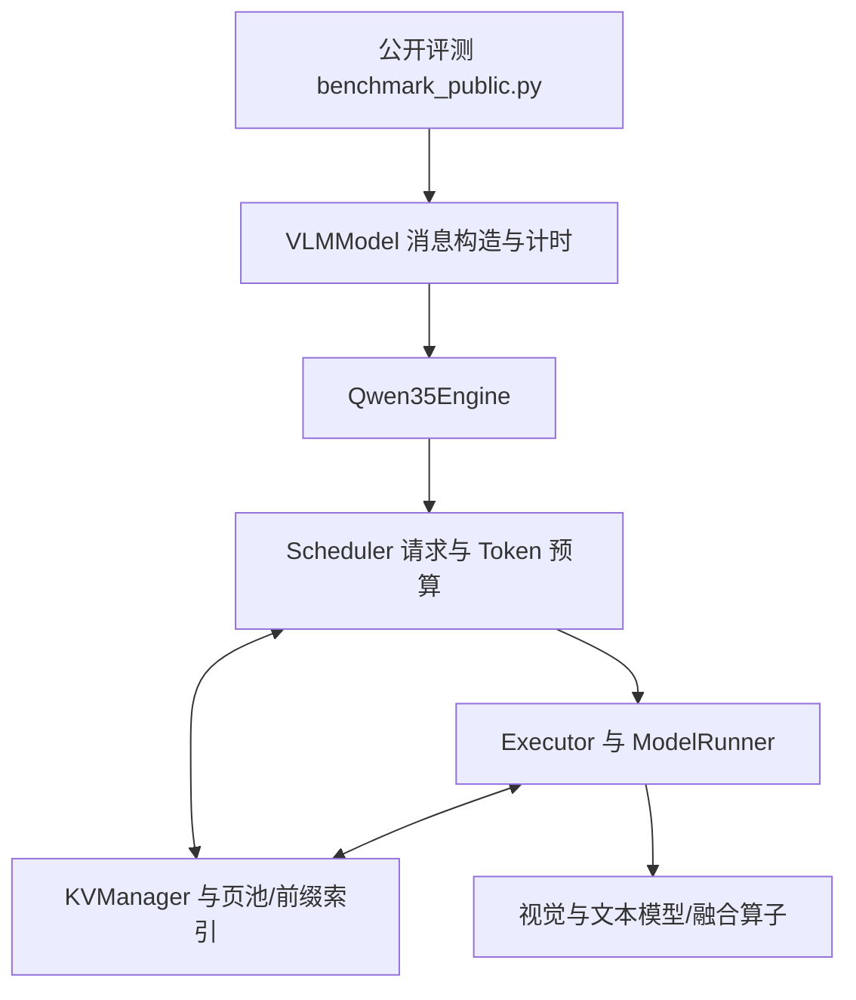

# 架构与执行边界

## 分层

- `evaluation_wrapper.py`：保持比赛数据结构；识别特定固定任务说明，按开关拆分 system 指令与图片后的动态问题；构建图像身份与 placeholder 范围。
- `src/control/engine.py`：模型、Processor 和请求执行入口。
- `src/control/scheduler.py`：决定本步 Prefill/Decode 的 Token 数，配合缓存边界、分块与请求状态推进。
- `src/data/manager.py` 与 `block_manager.py`：物理块管理、前缀匹配、资源准入和回收。
- `src/data/hybrid_cache.py`、`hybrid.py`：混合层布局以及递归/卷积状态。
- `src/data/prefix/`：Hash、Radix 与无缓存索引路径。
- `src/compute/executor.py`、`model_runner.py`：执行准备、模型调用、缓冲区和图执行。
- `src/compute/layers/`：分页 Attention、Norm/MRoPE、激活、Gated DeltaNet 与卷积调用。

## 混合状态恢复

Full Attention 的历史以分页 KV 表示；线性注意力层还依赖递归状态与卷积窗口。缓存恢复必须对应同一前缀边界，并考虑 MRoPE 位置相关状态。仅命中 token hash 或 KV 页，并不足以证明混合模型可恢复。

`KVManager._make_allocation_plan` 会寻找带混合快照的命中边界；系统短前缀存在不足物理页的独立复用路径。多模态媒体身份来自像素/张量与相关元数据，媒体相交区间加入块哈希，后续块通过 parent hash 继承依赖。

## 能力与限制

完整前缀复用、稀疏快照、自适应准入有实现，但完整前缀缓存默认关闭。系统前缀缓存默认开启。`max_num_seqs=1`，不能仅凭存在调度器就宣称支持高并发生产服务。PPU 适配依赖厂商环境，不应把第三方算子调用全部表述为自研 kernel。
